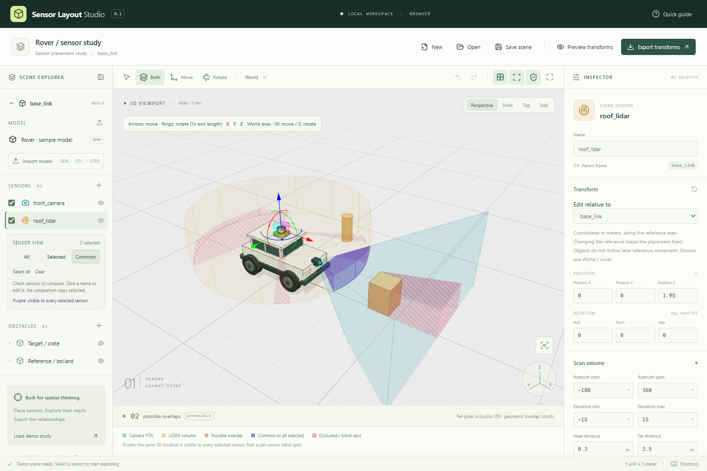
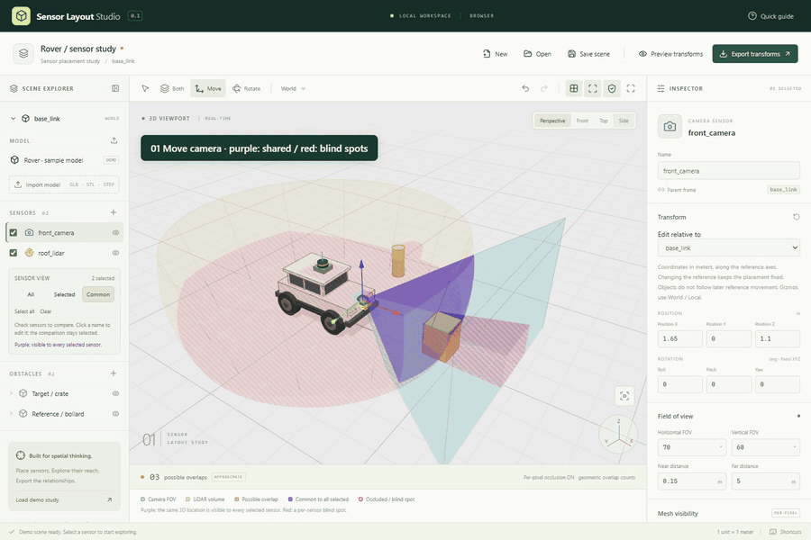

# Sensor Layout Studio

**Move sensors. Adjust their field of view. See shared coverage and blind spots update.**



## See it in action



**① Move camera → ② Camera FOV → ③ Camera range → ④ Move LiDAR → ⑤ LiDAR range. Purple marks shared visibility; red hatching marks per-sensor blind spots.** Recorded from the actual application. The GIF plays at 4× speed with shorter interaction pauses. Occlusion and blind-spot highlighting are both ON, so shared visibility and blind spots update together.

[日本語](README.ja.md)

A 3D workspace for planning camera and LiDAR placement on vehicles and robots. Adjust a sensor's pose and sensing volume, inspect occlusion and shared visibility, then save the study and export coordinate transforms for downstream tools.

**Windows desktop and browser versions. Models are processed locally; they are not uploaded to a server.**

## What you can do

| Task                                   | Tools                                                                                          |
| -------------------------------------- | ---------------------------------------------------------------------------------------------- |
| Plan mounting position and orientation | Move/rotate gizmos, numeric fields, model/sensor-relative editing, undo/redo                   |
| Adjust sensing volumes                 | Camera FOV, LiDAR azimuth/elevation, near and far distances                                    |
| Inspect overlap and blind spots        | Focus on selected sensors, shared visibility in purple, per-sensor blind spots in red hatching |
| Use your own vehicle or equipment      | GLB, STL and STEP import with origin, orientation and scale adjustment                         |
| Save and use the result                | Scene JSON, transform preview, quaternion and 4×4 matrix export                                |

## Try it in your browser

**[Launch the browser demo](https://matsushimax.github.io/SensorLayoutStudio/)** — no installation needed; start with the built-in scene. Windows downloads are being prepared.

### Run locally

Install **Node.js 22.12+ (24 recommended)** and use a WebGL-capable browser. Download or clone this repository, then run these commands in its folder. Rust is not needed for the browser version.

```sh
npm ci
npm run dev
```

Open **http://127.0.0.1:1420**. On Windows PowerShell, use `npm.cmd` if the execution policy blocks `npm.ps1`.

### Your first minute

1. Select `front_camera` in the built-in demo and drag a move arrow or rotation ring.
2. Change **Horizontal FOV** or **Far distance** in the inspector.
3. Check both sensors in the left panel and select **Common**. Purple shows their shared visibility.
4. Enable **Highlight blind spots** to inspect per-sensor occlusion in red hatching.
5. Open **Preview transforms** to check relative poses, then **Save scene** to keep the layout.

Left-drag to orbit, right-drag to pan, scroll to zoom, and press **F** to focus the selected object.

## Import a model

Use **Import model** in the left panel. Original example files let you try each format without supplying your own CAD data.

| Format     | Import behavior                                             | Example                                                   |
| ---------- | ----------------------------------------------------------- | --------------------------------------------------------- |
| GLB        | Self-contained glTF 2.0; proposes Y-up → Z-up alignment     | [calibration-box.glb](examples/calibration-box.glb)       |
| STL        | ASCII or binary; assumes mm, editable through **STL units** | [calibration-block.stl](examples/calibration-block.stl)   |
| STEP / STP | Tessellated locally; embedded units converted to meters     | [calibration-block.step](examples/calibration-block.step) |

The STL/STEP examples import as **1 × 2 × 3 m** blocks. Check your model's origin, orientation and scale. Maximum file size: 100 MB; STL/STEP: up to 500,000 triangles. STEP conversion supports cancellation and a 60-second timeout.

Scene JSON references model filenames rather than embedding the model bytes. Re-select the model after reopening a study; its saved alignment and scale are preserved.

## Read the visualization

- **Purple:** the same 3D point lies inside every selected sensor's volume and, with occlusion ON, is visible from every selected origin. Screen-space overlap alone does not count.
- **Red hatching:** a blind spot for an individual sensor. Another sensor may still see that location.
- **possible / none:** a separate conservative FOV/obstacle intersection estimate, independent of shared visibility and occlusion.

This is a **layout visualization tool**. Accuracy depends on the input triangle mesh, rendering resolution and numerical tolerances. STEP surfaces are tessellated too. The app does not compute area, volume, coverage percentages, detection probability or reflectance. Interactive performance with large production models has not been established.

## Develop or build the Windows app

In addition to Node.js, install Rust stable MSVC, Microsoft C++ Build Tools with the Windows SDK, and WebView2. See [Tauri's prerequisites](https://v2.tauri.app/start/prerequisites/).

```sh
npm ci
npm run tauri dev
# Build the executable and installer
npm run tauri build
```

Executable: `src-tauri/target/release/sensor-layout-studio.exe`. Installer: `src-tauri/target/release/bundle/nsis/`. Local builds are unsigned. GitHub Actions runs checks and builds Windows artifacts; it does not automatically publish a Release.

## Technology and validation

**Tauri v2 / React / TypeScript / Three.js / React Three Fiber / Zustand.** GPU ray/triangle queries determine occlusion; shared visibility combines the selected sensors' tests at the same world-space point. Numerical unit tests cover coordinate transforms, and browser tests verify rendered output and real editing interactions.

```sh
npm run build
npm test
npx playwright install chromium
npm run test:e2e
npm run format:check
```

[User guide and calculation limits](docs/usage.md) · [Architecture](docs/architecture.md) · [Validation record](docs/validation.md) · [Regenerate the demo](docs/demo-production.md) · [Example transform export](examples/demo.transforms.json)

## License

Application code, the original rover and example models are **MIT** licensed. See [LICENSE](LICENSE), [npm notices](THIRD_PARTY_NOTICES.md) and [Rust notices](THIRD_PARTY_RUST_NOTICES.md). STEP support uses Open CASCADE Technology / occt-import-js (LGPL-2.1 with the OCCT exception). [Corresponding source and rebuild instructions](docs/cad-runtime.md) are included.
