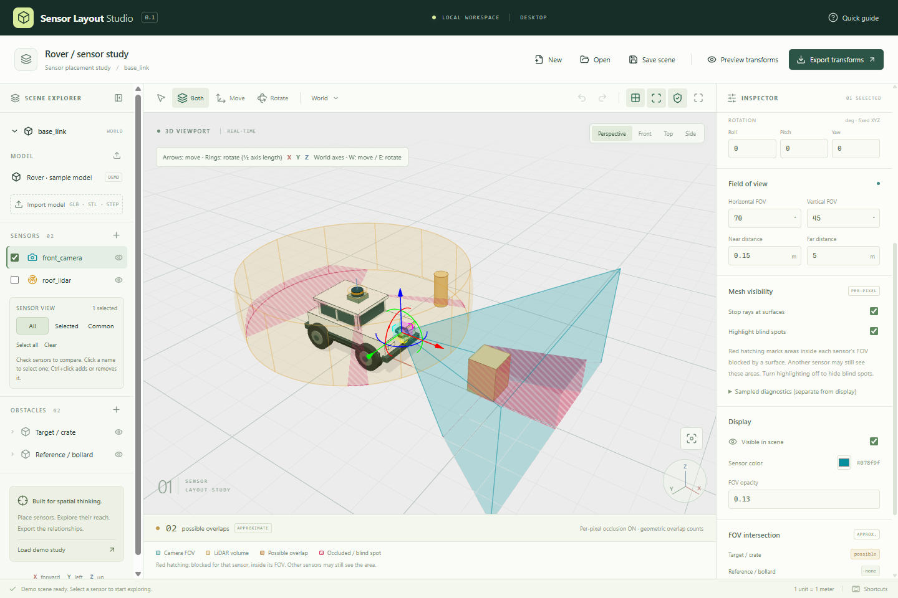
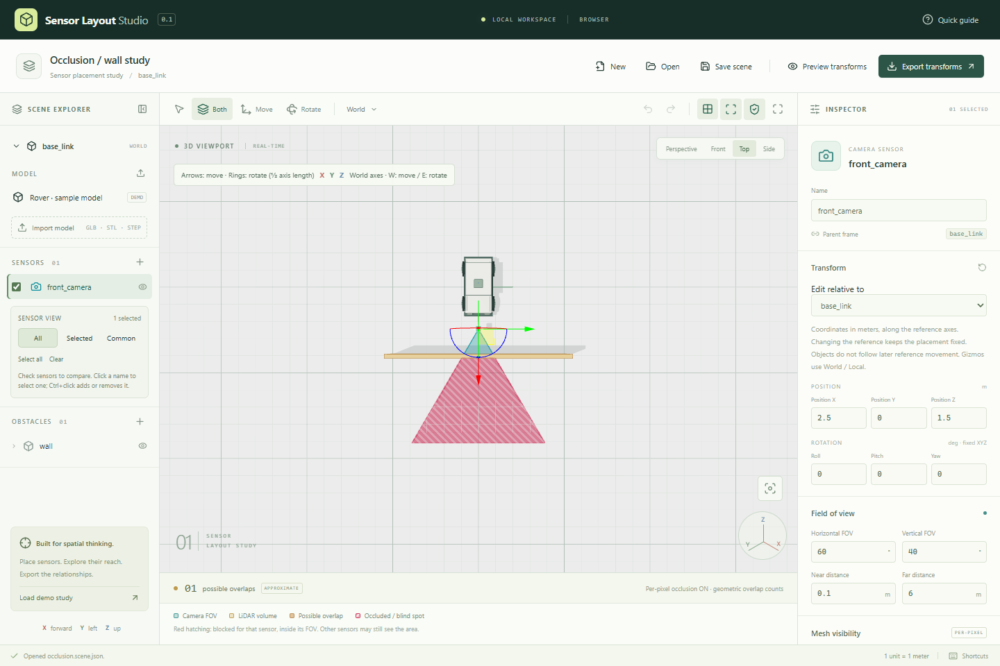
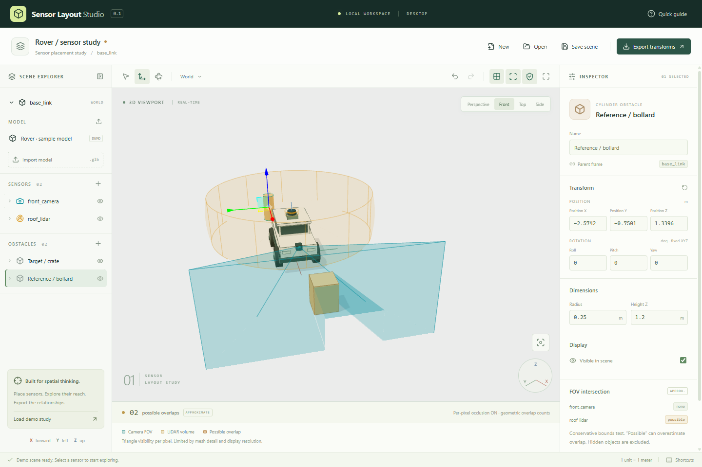

# 操作ガイド・計算上の範囲

[READMEに戻る](../README.ja.md)

## 操作

起動時のデモで`front_camera`を選択し、ギズモまたは数値で位置・画角を変更できます。`roof_lidar`では方位角・仰角・測距範囲を変更できます。障害物を動かすと、概略交差の`possible / none`表示が更新されます。

左ドラッグで周回、右ドラッグでパン、ホイールでズーム。**W**で移動、**E**で回転、**F**で選択対象に注目します。**Ctrl+S**で保存、**Ctrl+O**で読込、**Ctrl+Z**でUndo、**Ctrl+Shift+Z**でRedo、**Ctrl+D**で複製できます。

カメラやLiDARを選択すると、移動矢印と回転リングを同時に表示します（**Both**）。リングの半径は、原点から移動矢印の先端までの長さの半分です。赤いリングはX軸、緑はY軸、青はZ軸まわりの回転です。**World／Local**で世界座標の軸かセンサ自身の軸かを切り替えられます。回転は右側のRoll／Pitch／Yawと視野表示に反映され、ドラッグ1回をUndoで戻せます。**Move**（**W**）／**Rotate**（**E**）で片方だけを表示し、**Both**で同時表示に戻せます。

**Edit relative to** で、数値入力する位置・姿勢の基準を `base_link`／インポートしたモデル／他のセンサーから選択できます。基準を切り替えても配置は変わりません。モデル基準ではモデルの原点・回転を使い、距離は拡大率によらずメートルです。親子関係の設定ではないため、基準を後から動かしても他の対象は追従しません。保存する姿勢は引き続き `base_link` 基準で、ギズモの軸は **World／Local** に従います。Transform欄のリセットは `base_link` の原点・姿勢に戻します。

**Preview transforms** では基準Aと対象Bを選び、BのAに対する位置・RPY・Quaternion・4×4変換行列を確認できます。**Exact export JSON** は実際に保存する全センサーの変換データで、その場で **Save transforms JSON** から保存できます。モデル相対の値はプレビュー専用です。センサー名が重複した場合は `_2`、`_3` の連番を付けて区別します（変更・複製・シーン読込に対応）。`base_link` と `model` も予約名として区別します。

ツールバーの盾ボタン、またはセンサの「Stop rays at surfaces」で遮蔽を切り替えられます。ONではFOVの各画素からセンサへの線分と三角形メッシュを照合します。見える範囲はセンサの色、遮蔽物の奥の死角は**赤色＋斜線**で表示します。「Highlight blind spots」は初期状態でONです。OFFにすると死角を隠し、見える範囲だけを表示できます。赤色は各センサから見た死角で、別のセンサがその場所を見ている場合もあります。FOV外は死角として着色しません。遮蔽自体をOFFにすると理論上のFOV全体を表示します。これらの表示設定はシーンJSONには保存しません。

「Sampled diagnostics」を開くと、別計算の光線サンプル数と最短サンプル衝突距離を確認できます。この参考値は画面の影を生成していません。

センサ一覧のチェックボックスで、表示・比較するセンサを複数選べます。「SENSOR VIEW」の **All** は全センサ、**Selected** はチェックしたセンサだけの視野、**Common** はチェックした全センサの共通範囲を濃い紫色で表示します。共通範囲の強調には表示中のセンサを2台以上選択してください。非表示のセンサは対象から除外されます。

共通範囲は同じ3D地点が全選択センサの画角・距離範囲内にあり、遮蔽ONでは全センサから遮られずに見える範囲です。画面上で視野が重なって見えるだけの場所は共通扱いしません。遮蔽OFFでは幾何学的なFOVの共通範囲になります。赤い死角表示は引き続き各センサ単位で、全センサ共通の死角を意味しません。

名前のクリックは単独選択、Ctrl+クリックは追加・解除です。Commonモードでは名前をクリックしても比較対象を維持し、右パネルで編集するセンサだけを切り替えます。選択と表示モードは一時的なUI設定で、シーンの変更履歴やJSONには含みません。共通範囲の面積・体積・割合の計算は行いません。

遮蔽物の実際の輪郭から影の側面を生成し、斜めから見た際も視野と影の境界をつなぎます。センサと同じ平面や浅い入射角の面では、自分自身を遮ったと誤判定して細かな斑点が出ないよう処理しています。

GLB読込の確認には`../examples/calibration-box.glb`を使えます。GLBではY-up→Z-up変換を初期提案します。STL／STEPの確認には`../examples/calibration-block.stl`と`.step`を使えます（1000×2000×3000 mm、読込後1×2×3 m）。前方軸・原点・縮尺はモデルに合わせて調整してください。シーンJSONにはモデル本体や絶対パスを含めないため、復元後にはファイルの再選択が必要です。再選択時は保存した位置・姿勢・縮尺を維持します。

**STL** はASCII／バイナリに対応します。単位情報を持たないため、初期値は **mm・Z-up** です。右側の **STL units** でmm／cm／m／inchを選べます。元データに合わせて向きも調整してください。

**STEP（.step／.stp）** は端末内のOpenCascadeで三角形メッシュに変換します。ファイル内の単位をメートルに変換し、座標軸は維持します。線形偏差0.5 mm・角度偏差0.1 radで曲面を近似するため、厳密なCAD曲面そのものではありません。表示用メッシュ・部品名・メッシュ色を取り込み、CADの編集履歴や面単位の色は保持しません。外部参照を含むアセンブリは単一のSTEPに書き出してください。

STL／STEPは100 MB・50万三角形まで。STEP変換は画面操作と分離し、キャンセルと60秒のタイムアウトに対応します。この上限は快適動作を保証する規模ではありません。IGESと各CAD固有のネイティブ形式は未対応です。

## 計算上の範囲

- 右手系、X前方・Y左方・Z上方。距離はm、UI角度は度。
- RPYは固定軸XYZ、`R = Rz × Ry × Rx`。保存姿勢は正規化した`[x,y,z,w]`。
- `T_A_B`はB座標をA座標へ変換します。行列出力はrow-major。
- GLBは100MB以下・外部参照なしのglTF 2.0に対応します。Draco／Meshopt／KTX2圧縮やアニメーション再生は対応範囲外です。
- `possible`は境界球とセンサ範囲の保守的な判定で、実際の形状より広く判定される場合があります。`none`は境界上で分離できたことを示します。非表示オブジェクトは判定から除外します。
- 遮蔽表示は、各描画画素からセンサへの光線と三角形メッシュの交差をGPUで調べます。影の境界は固定の角度サンプルに依存せず、従来の光線間に入る細い障害物も画面に影を作れます。nearより手前の面も遮り、ガラスを含む面は不透明として扱います。精度は入力メッシュ・浮動小数点の許容誤差・画面解像度に制約されます。LiDARの曲面は最大約2度間隔のポリゴンで表現します。連続空間で厳密な影の立体形状や体積を求める機能ではありません。
- 参考値の光線統計は、カメラ49×33方向、LiDAR約2度間隔のサンプル計算を継続して使います。細い障害物を見逃す場合があり、画面の遮蔽結果とは区別します。
- 概略交差の`possible / none`と重なり件数には遮蔽を加味しません。遮蔽プレビューと光線サンプル数は、検出確率やカバレッジ率を表しません。
- 遮蔽ヒートマップ、取り付け衝突、認識性能、反射強度、スキャン時間は評価しません。

座標変換、保存復元、不正データの拒否、編集履歴を単体テストで検証し、ブラウザで実際のギズモ操作、GLB取込・再選択、JSON保存読込をテストしています。
